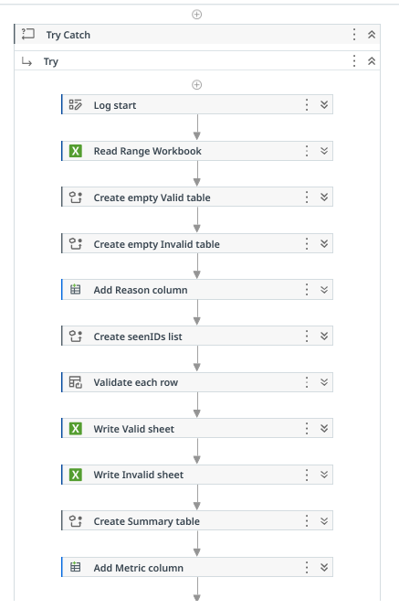
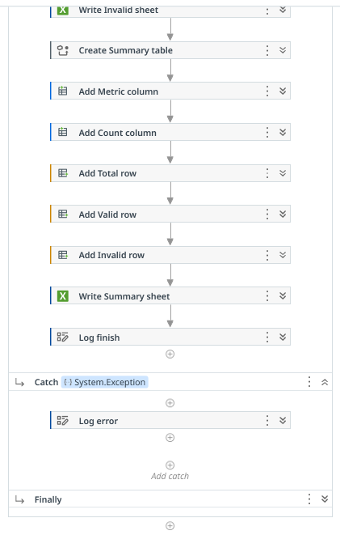
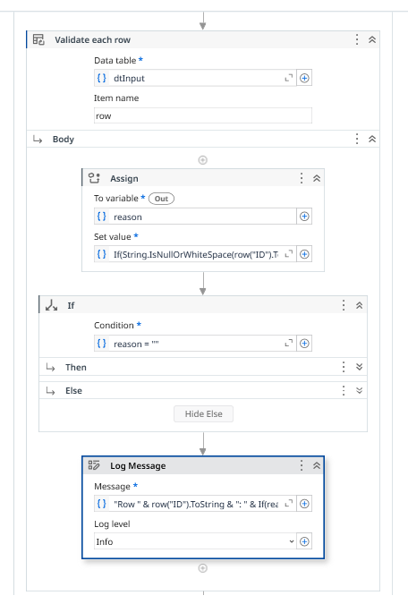
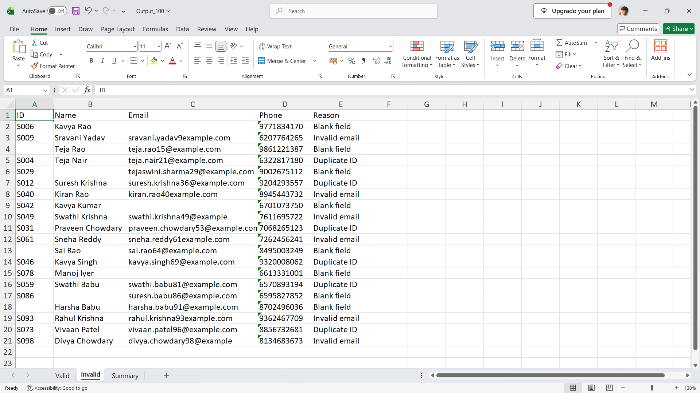
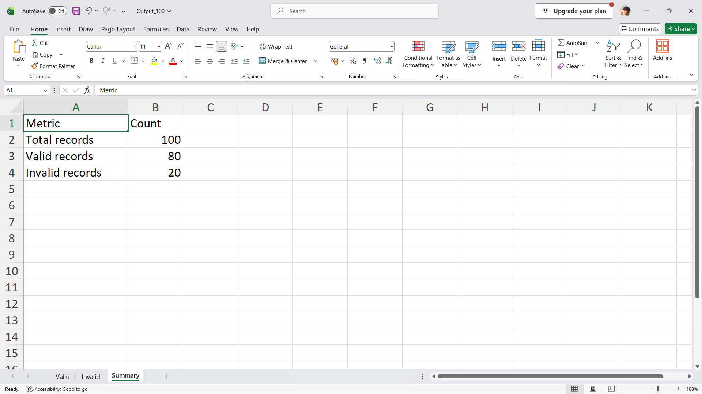

# Excel Data Validation & Reporting Bot (UiPath)

A UiPath RPA bot that reads an Excel file of records, checks every row for common data-quality problems, and separates good records from bad ones, with the reason for each rejection.

## Problem it solves
Data collected in Excel often has blank fields, duplicate IDs and badly formatted emails. Checking this by hand is slow and error-prone. This bot does the check automatically and produces a clean output file and a summary.

## What it does
1. Reads the `Data` sheet from an input workbook.
2. Checks each row, in this order:
   - **Blank field**: ID, Name or Email is empty
   - **Duplicate ID**: the ID has already appeared (the later row is flagged)
   - **Invalid email**: the email does not match a basic `name@domain.ext` pattern
3. Writes three sheets to the output workbook:
   - **Valid**: clean records
   - **Invalid**: rejected records with a `Reason` column
   - **Summary**: total, valid and invalid counts
4. Logs every row's result and handles errors with Try/Catch.

## Tools
UiPath Studio Community (VB), Excel Workbook activities (Read Range, Write Range), DataTables, regular expressions.

## Test results
| Input file | Records | Planted errors | Valid | Invalid |
|---|---|---|---|---|
| `Input_50.xlsx` | 50 | 10 (4 blank, 3 duplicate, 3 invalid email) | 40 | 10 |
| `Input_100.xlsx` | 100 | 20 (8 blank, 6 duplicate, 6 invalid email) | 80 | 20 |

The bot flagged all 30 planted errors, and each Reason matched the `Answer Key` sheet in the input files. The sample data is synthetic and was created for testing.

## Files
- `Main.xaml`, `project.json`: the UiPath project
- `Input_50.xlsx`, `Input_100.xlsx`: test data (each has an `Answer Key` sheet)
- `Output_50.xlsx`, `Output_100.xlsx`: bot results
- Screenshots: `first_half.png`, `second_half.png` (workflow), `validation-loop.png` (row checks), `invalid.png`, `summary.png`

## Screenshots
### Workflow

### Validation loop

### Output: Invalid sheet

### Output: Summary sheet

## How to run
1. Open the project in UiPath Studio Community.
2. In **Read Range Workbook**, set the input path to your file (for example `Input_50.xlsx`).
3. In the three **Write Range Workbook** activities, set the output path.
4. Click **Run**. The results appear in the output workbook, and the log shows each row.

## Possible improvements
- Phone number validation
- Email the summary report
- Load valid records into a database
